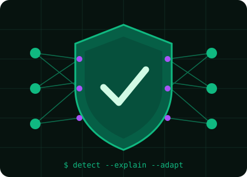

<div align="center">


# Hi, I'm Linda Maria Gomes 👋

### CSE Undergraduate | Cybersecurity & Machine Learning Researcher | Aspiring Security Specialist


<br>

<p align="center">
  <a href="https://github.com/marialindagomes" target="_blank">
    
  </a>
  <a href="https://www.linkedin.com/in/linda-maria-gomes-a71151276/" target="_blank">
    
  </a>
  <a href="https://www.researchgate.net/profile/Linda-Maria-Gomes" target="_blank">
    
  </a>
  <a href="https://orcid.org/0009-0007-2551-9609" target="_blank">
    
  </a>
  <a href="mailto:marialindagomes29@gmail.com" target="_blank">
    
  </a>
</p>


</div>

---

<div align="center">

## 🐍 My GitHub Contributions


</div>

---

## 👩‍💻 About Me



I am a **Computer Science and Engineering student** at **American International University-Bangladesh**, graduating in **December 2026**. I am passionate about **Cybersecurity, Machine Learning, Networking and research-driven software development**.

I enjoy building intrusion detection systems that are not only accurate but also **explainable** and **robust to concept drift**, from dataset auditing and feature engineering to model evaluation, SHAP analysis, and scientific writing.

- 🔐 Researching **ML-based intrusion detection for network and IoT traffic**
- 🧠 Interested in **explainable AI and stable model explanations**
- 🐞 Studied **software defect prediction** with ensemble and neural models
- 🧪 Careful about **data leakage, dataset integrity, and fair evaluation**
- 📝 Document experiments with **Python, GitHub, and LaTeX (Overleaf)**
- 🎨 Graphic designer who turns research into **clear visuals**
- 🎯 Goal: **internships now, higher studies and research in Cybersecurity next**

<br clear="right"/>

---

## 🛠️ Tech Stack & Tools

<div align="center">

### Programming Languages


### Machine Learning & Data Science


### Security, Networking & Operating Systems


### Web, Database & Research Tools


### Design Tools


</div>

---

## 📊 GitHub Analytics

<div align="center">


<br><br>


</div>

---

## 🧠 Research & Development Focus

<div align="center">


</div>

---

## 📄 Publications & Manuscripts

<div align="center">

| Paper | Method and result | Venue | Status |
|:--|:--|:--|:--:|
| **AdaptiveExplain-IDS**: explainable, drift-aware IoT threat detection | XGBoost + SHAP + ADWIN · **99.50% accuracy, 99.74% F1** on CICIoT2023 | ICREST 2027 | Submitted |
| **Ensemble learning-based NIDS** on CICIDS2017 | Soft voting of LR, DT, RF, XGBoost · **99.64% accuracy** | ICCIT 2026 | Submitted |
| **SHAP consistency** for software defect prediction | RF, XGBoost, LightGBM, MLP on NASA JM1 · VIF-guided RF-RID · **CECI 0.946** | ICCIT 2026 | Submitted |
| **Leakage-aware audit**, mango leaf disease images *(co-author)* | CNN, ResNet50, EfficientNet-B0 · accuracy drops up to 7.78% | ICREST 2027 | Submitted |
| **Smart food spoilage detection**, Arduino and IoT *(co-author)* | MQ-4, DHT11, ESP8266 · **96.35% accuracy** | ECCE 2027 | Submitted |
| **Renewable energy for flood-affected areas** *(co-author)* | Hybrid solar, micro-hydropower and battery system | IEEE CS BDC 2025 | Presented |
| **Arsenic contamination and public health cost** *(co-author)* | 2000–2023 time-series analysis | NBHRC 2025 | Presented |

</div>

---

## ⚡ What I Like to Build

<div align="center">

<table>
<tr>
<td align="center" width="250">
<h3>🛡️ Detection Systems</h3>
<p>Ensemble and drift-aware intrusion detection for network and IoT traffic</p>
</td>
<td align="center" width="250">
<h3>🔍 Explainable Pipelines</h3>
<p>SHAP-based analysis, stable explanations, and leakage-aware evaluation</p>
</td>
<td align="center" width="250">
<h3>🌐 Full-Stack Apps</h3>
<p>Role-based web platforms, desktop tools, and AI-assisted applications</p>
</td>
</tr>
</table>

</div>

---

## 🚀 Featured Projects

<div align="center">

<table>
<tr>
<td align="center" width="260">
<h3>🧭 Travel Mate</h3>
<p>AI destination recommendations, itinerary planning, service booking, and SOS live-location sharing</p>
<sub>Agile Scrum · Software Engineering</sub>
</td>
<td align="center" width="260">
<h3>🍔 FoodExpress</h3>
<p>Online food ordering and delivery with Admin, Customer, and Delivery dashboards</p>
<sub>PHP · MySQL · JavaScript · AJAX · CSS</sub>
</td>
<td align="center" width="260">
<h3>📈 BazarWatch_BD</h3>
<p>Market price monitoring and analytics desktop app with automated reports and tests</p>
<sub>Python · GUI</sub>
</td>
</tr>
<tr>
<td align="center" width="260">
<h3>🛡️ IDS & XAI Experiments</h3>
<p>Ensemble, explainable, and drift-aware detection pipelines from my research papers</p>
<sub>Python · scikit-learn · XGBoost · SHAP</sub>
</td>
<td align="center" width="260">
<h3>🛒 Shop Management</h3>
<p>Inventory, sales, and billing system with product and transaction management</p>
<sub>C#</sub>
</td>
<td align="center" width="260">
<h3>📚 Library Management</h3>
<p>Book management, borrowing, and reporting features</p>
<sub>Java</sub>
</td>
</tr>
</table>

</div>

---

## 🎯 Current Focus

<div align="center">

```python
class LindaMariaGomes:
    def __init__(self):
        self.role = "CSE Undergraduate @ AIUB (graduating Dec 2026)"
        self.interests = [
            "Cybersecurity",
            "Intrusion Detection",
            "Explainable AI",
            "Concept-Drift Handling"
        ]
        self.tools = [
            "Python",
            "XGBoost",
            "scikit-learn",
            "SHAP",
            "Wireshark",
            "LaTeX"
        ]
        self.goal = "Build secure, transparent, and explainable AI systems"

    def currently_seeking(self):
        return [
            "Internship Opportunities",
            "Research Collaboration",
            "Higher Studies in Cybersecurity"
        ]
```

</div>

---

## 🎓 Education

<div align="center">

| Period | Details |
|:--|:--|
| 2023 – Dec 2026 *(expected)* | **B.Sc. in Computer Science & Engineering**, American International University-Bangladesh |
| Jun – Dec 2023 | **Graphic Designer Intern**, Nokrek IT Institute, Dhaka |
| 2022 / 2020 | HSC (Science), Holy Cross College / SSC (Science), Banani Bidyaniketon School & College |

</div>


---

## 🌐 Connect With Me

<div align="center">

I am open to **internships, research collaboration, and cybersecurity or ML projects**.

<br>

[](https://github.com/marialindagomes)
[]([www.linkedin.com/in/linda-maria-gomes-a71151276])
[](https://www.researchgate.net/profile/Linda-Maria-Gomes)
[](https://orcid.org/0009-0007-2551-9609)
[](mailto:marialindagomes29@gmail.com)

</div>

---

<div align="center">

### ⭐ Thanks for visiting my profile!


</div>
